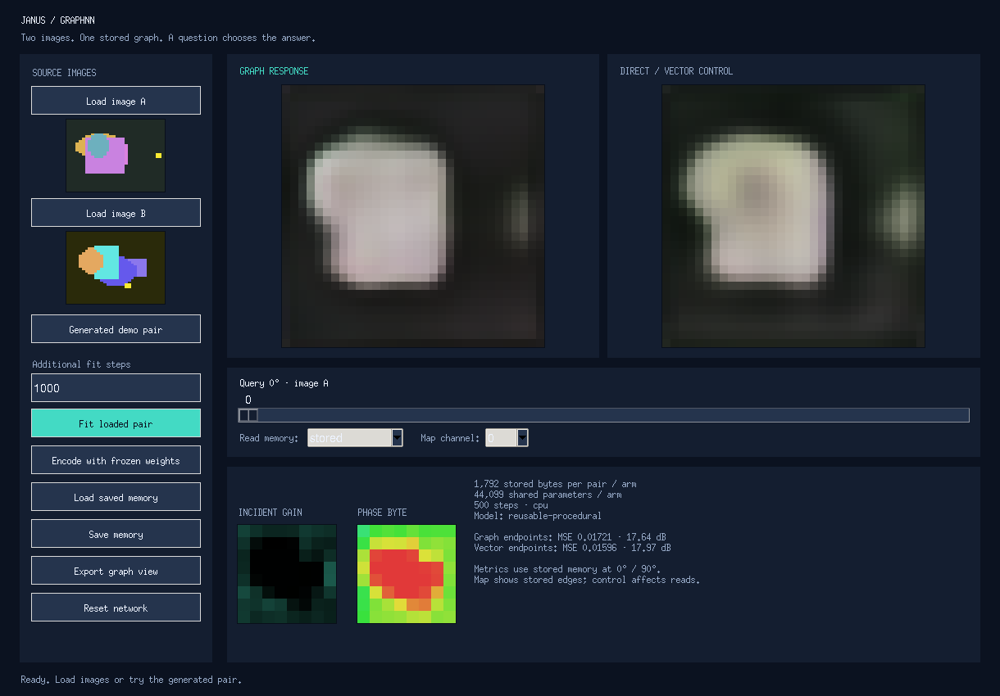
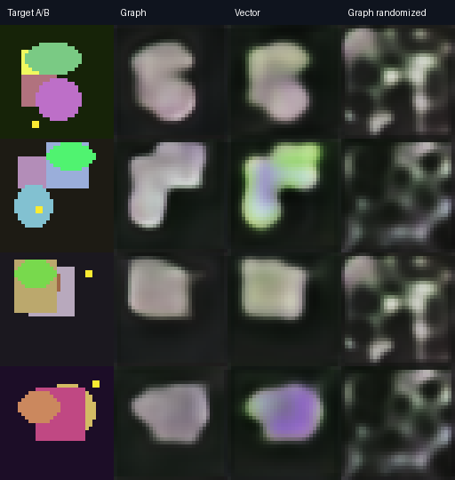

# GraphNN — Janus with an explicit graph memory

A runnable successor experiment to Janus Cabbage: load two images, write
them into a learned gain/phase graph, then move a query slider to read A,
B, or an intermediate response. A matched direct/vector reader runs beside
it. Both use **1,792 stored bytes per image pair** and **44,099 shared
parameters** with the default settings.



## Run the GUI

Download the **whole repository** with GitHub's **Code → Download ZIP**, or:

```text
git clone https://github.com/anttiluode/GraphNN.git
cd GraphNN
python -m pip install -r requirements.txt
python janus_cabbage_graph.py
```

Python **3.10+** is required. Windows' standard Python installer includes
Tkinter; `run_gui.bat` also starts the app using your current Python.
On Linux install `python3-tk` and run in a desktop session. On macOS use a
Python distribution with Tk support. The app selects CUDA if your installed
PyTorch build supports it and the GPU is available; CPU works as well.
An existing compatible CUDA PyTorch installation can be reused.

For an isolated environment in Windows Command Prompt:

```bat
python -m venv .venv
.venv\Scripts\activate.bat
python -m pip install -r requirements.txt
python janus_cabbage_graph.py
```

The bundled pilot weights initialize a generated demo pair with **frozen
weights**, so there is something to inspect immediately. Click **Fit loaded
pair** for the original Janus-style fitting workflow. Use `--device cpu`
to force CPU. To read a saved memory without loading its original images:

```text
python janus_cabbage_graph.py --checkpoint results/pilot/memory.pt
```

## What to try

1. Load image A and B; each is resized to 32x32. Loading a complete pair
   encodes it with the current frozen weights.
2. Set the additional fit steps, then click **Fit loaded pair**. **Pause**
   takes effect after the current step; fitting can be resumed.
3. Move the slider: **0° asks for A**, **90° asks for B**. Intermediate
   queries have no supervised physical meaning and are not inferred 3D views.
4. Compare **Graph response** to **Direct / vector control**. Change
   **Read memory** to **randomized** or **blank**: the reader now receives
   altered bytes. The gain/phase maps continue to show the original stored
   edges. Endpoint metrics always refer to the unmodified stored memory.
5. **Save memory** stores model tensors and byte states, with no source
   pixels. **Load saved memory** clears the source thumbnails and still
   renders. Supply both source images again if you want to fit further.
6. **Encode with frozen weights** performs a fresh write without updating
   shared parameters. **Export graph view** saves the displayed graph answer
   at its native resolution.

The maps show average incident edge gain/phase **byte values** in the
selected channel. The phase map is a byte diagnostic, not an inferred
physical speed or an absolute coordinate field.

## The mechanism

```text
M_A  = Writer(image_A, query=0 degrees, previous=empty)
M_AB = Writer(image_B, query=90 degrees, previous=M_A)
RGB  = Reader(M_AB, new_query)
```

The small shared CNN proposes edge values. A learned context-dependent gate
combines them with the previous memory. Every forward write is rounded to
byte values with a straight-through gradient; saved and evaluated memory
uses actual uint8 tensors. The reader gets **memory and query only**, starts
from a fresh complex ping, and sees no pixels or retained writer activations.

The graph is an 8x8 fixed lattice with 112 undirected edges, eight channels,
and two bytes per channel/edge: gain and phase. The angle changes spatial
and channel excitation through sine/cosine query features; it is not merely
a global phase rotation. Complex responses at depths 0, 2 and 4 feed an RGB
decoder. Transport is **dissipative**, not an exact unitary interferometer;
no common-path cancellation or biological implementation is claimed.

The **vector control** uses an independent copy of the same writer
architecture, gate, query generator and decoder. It interprets the 1,792
stored scalars directly, reshapes them for the convolutional decoder, and
performs no graph transport. Parameters, batches and optimization steps
match; inference computation differs. This control tests the value of
transport within this architecture, not every possible vector codec.

## First measured pilot

Seed 41; 500 optimization steps; 128 procedural training pairs and 32
independent held-out pairs; both endpoints queried; actual byte states.

| Reader | Held-out MSE ↓ | PSNR ↑ | Shuffled memory MSE | Blank memory MSE |
| --- | ---: | ---: | ---: | ---: |
| Graph transport | 0.016708 | 17.77 dB | 0.074652 | 0.115443 |
| Direct / vector | **0.014722** | **18.32 dB** | 0.078400 | 0.085948 |

**The vector control wins this pilot.** Both readers depend on the stored
memory; shuffling it greatly damages reconstruction. Images are blurry and
tiny details are often lost. One procedural seed does not establish a
robust architectural advantage or generalization to natural photos.



[Exact metrics](results/pilot/metrics.json) include parameter/weight bytes
and descriptive evaluation times. Each arm has 176,396 bytes of shared
float32 weights in addition to its 1,792-byte pair state. Shared weights
must not be counted as free information. Two source RGB arrays occupy
6,144 bytes at this resolution; the pilot learns a lossy, task-specific code.

## Fitting a pair versus learning a reusable writer

GUI **pair fitting updates shared writer and reader weights** using the
loaded targets, like original Janus. Those weights can also memorize that
pair. A successful GUI fit alone is not proof that all pair information
lives in the graph, nor a fair compression benchmark.

The pilot instead trains the writer/readers across many pairs and freezes
their weights before held-out encoding. Run that workflow with:

```text
python train.py --steps 500 --seed 41 --device auto --output runs/pilot
python janus_cabbage_graph.py --checkpoint runs/pilot/memory.pt
```

The checkpoint holds one held-out memory as an immediate example. To test
the frozen writer on another pair, load A and B after loading the checkpoint.
Changing an observation changes edge values in a fixed topology; neither
topology nor an adaptive interrogation policy is learned here. B updates
the same memory after A; loss on both endpoints encourages preservation.
This is not an arbitrary-length online-history retention test.

## Verify

```text
python -m unittest discover -s tests -v
python train.py --steps 2 --train-count 4 --test-count 4 --batch-size 2 --device cpu --output runs/smoke
```

Linux GUI verification uses `xvfb-run -a python -m unittest discover -s tests -v`.
Without a display, only the GUI tests are skipped. CI runs real Tk widgets
under Xvfb, including training/pause/slider and loading source-free memory.

Related mechanisms: [SihtiResponseGraph](https://github.com/anttiluode/SihtiResponseGraph),
[SihtiGrapImageModel](https://github.com/anttiluode/SihtiGrapImageModel),
[NextLevel](https://github.com/anttiluode/NextLevel). GraphNN gives these
ideas an inspectable Janus-style experiment; it does not claim to replace
Transformers or evade finite memory capacity. MIT licensed.
