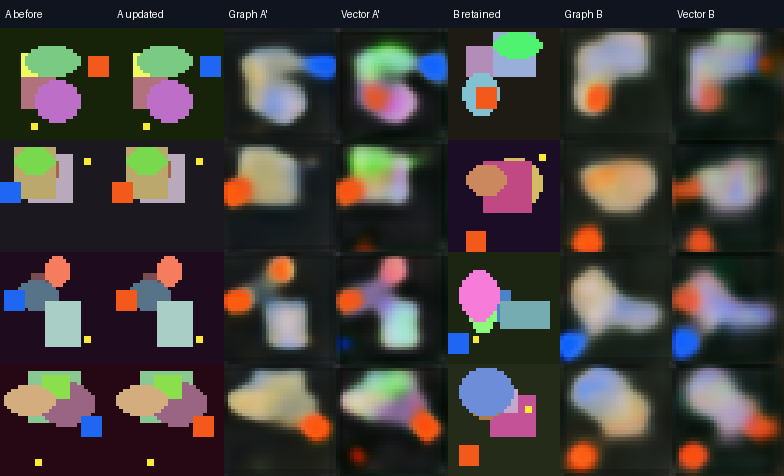

# GraphNN — Janus with an explicit graph memory

A runnable successor experiment to Janus Cabbage: load two images, write
them into a learned gain/phase graph, then move a query slider to read A,
B, or an intermediate response. A matched direct/vector reader runs beside
it. Both use **1,792 stored bytes per image pair** and **44,099 shared
parameters** with the default settings.


## Phase computer gate — actual 896-byte phase memory, trained from scratch (October 14)

**New finding:** training the A→B→A′ rewrite task with **only 896 persistent phase bytes** preserves both test marks in **384/384** held-out pairs (three training seeds, 500 steps each). The same-sized **gain-only graph** reaches 337/384, and the same-sized **direct vector** reaches 376/384. The original two-factor **1792-byte complex graph** also reaches 384/384. A stronger **1792-byte / 16-channel gain-only graph** with **more parameters** reaches 349/384. The phase-only model matches the original full graph while halving per-pair state and obtains lower mean B reconstruction MSE (0.01989 vs 0.02038).

| Model | Inference state | Shared parameters | Joint mark recovery | B MSE ↓ | B drift ↓ |
| --- | ---: | ---: | ---: | ---: | ---: |
| **Phase-only graph** | **896 bytes** | 43,211 | **100%** | **0.01989** | **0.000681** |
| Gain-only graph | 896 bytes | 43,211 | 87.76% | 0.06178 | 0.011864 |
| Direct vector | 896 bytes | 43,211 | 97.92% | 0.04414 | 0.017199 |
| Original complex graph | 1,792 bytes | 44,099 | 100% | 0.02038 | 0.000847 |
| Original direct vector | 1,792 bytes | 44,099 | 98.96% | 0.02743 | 0.009546 |
| Wide gain-only graph | 1,792 bytes | 58,035 | 90.89% | 0.05847 | 0.011409 |

This is a **trained** compressed graph, not merely the previous test-time phase ablation. But it remains a narrow 32×32 synthetic two-mark rewrite task. Phase-only vs gain-only does **not** yet distinguish complex U(1) interference from more general signed mixing; the graph is dissipative, not unitary, and no loop-holonomy mechanism has been demonstrated. Graph propagation has greater compute than direct vector lookup.

Read the [full analysis and per-seed receipts](results/phase_gate/REPORT.md), [protocol](docs/phase_computer_gate.md), and [machine-readable scores](results/phase_gate/pilot500/summary.json). [Phase gate CI run and saved models](https://github.com/anttiluode/GraphNN/actions/runs/38585101081) · [wide gain-only CI run](https://github.com/anttiluode/GraphNN/actions/runs/38585441325).

Train the new models, then open the side-by-side GUI:

```bat
python3.13 train_phase_gate.py --steps 500 --seeds 41 97 127 --device cpu --output runs/phase_gate
python3.13 phase_computer_gui.py --seed 41 --runs runs/phase_gate
```

The original `janus_cabbage_graph.py` GUI and its pretrained 1,792-byte models remain unchanged. The new viewer displays frozen phase-only/gain-only/vector models against the same held-out targets.

## Rewrite gate: update A while retaining B

The GUI now has **Write A**, **Write B** and **Flip A detail**. A single
write updates the existing byte state with frozen shared weights. Loading
an image stages it for writing; **Rebuild pair (frozen)** explicitly starts
a fresh A→B state. Choose the **rewrite** fit task to train A→B→revised A.

The [frozen protocol](docs/superpowers/specs/2026-10-14-rewrite-gate-design.md)
uses independent blue/orange 6x6 marks in procedural images. The last write
sees revised A and the previous bytes only. B's pixels are not replayed,
scoring masks are never reader inputs, and every write is quantized.

Three seeds, 500 training steps per seed, and 128 held-out pairs per seed;
both arms have the same architecture size, batches and supervision:

| After rewriting A | Graph transport | Direct / vector |
| --- | ---: | ---: |
| Updated A mark correct | 100% | 99.74% |
| B mark retained | 100% | 99.22% |
| Both correct | 100% (384/384) | 98.96% (380/384) |

**Both arms pass the rewrite gate. A consistent graph advantage is not
demonstrated:** joint scores are 100/100/100% for graph and
97.66/100/99.22% for vector, including a tied seed. This tests one rewrite
of a binary detail; RGB reconstructions remain blurry. It does not establish
unlimited retention or generalization to photographs.

Skipping the last write fails to recover the new A mark. Shuffling final
memory reduces mark accuracy to roughly chance. The runner also reports a
privileged fresh rebuild that sees B's pixels again. See the
[summary](results/rewrite_gate/pilot500/summary.json) and per-seed metrics.
The original pair-trained checkpoint is included as a comparison, but its
data and objective differ, so this is not an isolated curriculum ablation.



Reproduce the gate and inspect one saved state:

```text
python train_rewrite.py --steps 500 --seeds 41 97 127 --device auto --output runs/rewrite_gate
python janus_cabbage_graph.py --checkpoint runs/rewrite_gate/seed41/memory.pt
```

## Run the GUI

Download the **whole repository** with GitHub's **Code → Download ZIP**, or:

```text
git clone https://github.com/anttiluode/GraphNN.git
cd GraphNN
python -m pip install -r requirements.txt
python janus_cabbage_graph.py
```

Python **3.10+** is required. Windows' standard Python installer includes
Tkinter; `run_gui.bat` also starts the app using your current Python.
On Linux install `python3-tk` and run in a desktop session. On macOS use a
Python distribution with Tk support. The app selects CUDA if your installed
PyTorch build supports it and the GPU is available; CPU works as well.
An existing compatible CUDA PyTorch installation can be reused.

For an isolated environment in Windows Command Prompt:

```bat
python -m venv .venv
.venv\Scripts\activate.bat
python -m pip install -r requirements.txt
python janus_cabbage_graph.py
```

The bundled rewrite-trained weights initialize a generated marked demo pair
with **frozen weights**, so there is something to inspect immediately. Click
**Flip A detail**, then query B to inspect retention. Click **Fit loaded
pair** for the original Janus-style fitting workflow. Use `--device cpu`
to force CPU. To read a saved memory without loading its original images:

```text
python janus_cabbage_graph.py --checkpoint results/rewrite_gate/pilot500/seed41/memory.pt
```

## What to try

1. Load image A and B; each is resized to 32x32. Loading stages the images.
   Click **Write A/B** to update existing memory, or **Rebuild pair (frozen)**
   for a fresh pair state.
2. Set the additional fit steps and task, then click **Fit loaded pair**.
   **pair** fits the two endpoints; **rewrite** also trains an A update while
   retaining B. **Pause** takes effect after the current step.
3. Move the slider: **0° asks for A**, **90° asks for B**. Intermediate
   queries have no supervised physical meaning and are not inferred 3D views.
4. Compare **Graph response** to **Direct / vector control**. Change
   **Read memory** to **randomized** or **blank**: the reader now receives
   altered bytes. The gain/phase maps continue to show the original stored
   edges. Endpoint metrics use known, actually written targets and the
   unmodified stored memory, even if different source images are staged.
5. **Save memory** stores model tensors and byte states, with no source
   pixels. **Load saved memory** clears the source thumbnails and still
   renders. You can load and write A without B's source pixels; only known
   targets are scored. Supply both images again to fit further.
6. **Flip A detail** paints a contrasting patch on the written A and writes
   A alone. The retention report compares B's MSE before and after that write
   when B's target is known. **Export graph view** saves the displayed graph
   answer at its native resolution.

The maps show average incident edge gain/phase **byte values** in the
selected channel. The phase map is a byte diagnostic, not an inferred
physical speed or an absolute coordinate field.

## The mechanism

```text
M_A  = Writer(image_A, query=0 degrees, previous=empty)
M_AB = Writer(image_B, query=90 degrees, previous=M_A)
RGB  = Reader(M_AB, new_query)
```

The small shared CNN proposes edge values. A learned context-dependent gate
combines them with the previous memory. Every forward write is rounded to
byte values with a straight-through gradient; saved and evaluated memory
uses actual uint8 tensors. The reader gets **memory and query only**, starts
from a fresh complex ping, and sees no pixels or retained writer activations.

The graph is an 8x8 fixed lattice with 112 undirected edges, eight channels,
and two bytes per channel/edge: gain and phase. The angle changes spatial
and channel excitation through sine/cosine query features; it is not merely
a global phase rotation. Complex responses at depths 0, 2 and 4 feed an RGB
decoder. Transport is **dissipative**, not an exact unitary interferometer;
no common-path cancellation or biological implementation is claimed.

The **vector control** uses an independent copy of the same writer
architecture, gate, query generator and decoder. It interprets the 1,792
stored scalars directly, reshapes them for the convolutional decoder, and
performs no graph transport. Parameters, batches and optimization steps
match; inference computation differs. This control tests the value of
transport within this architecture, not every possible vector codec.

## First measured pilot

Seed 41; 500 optimization steps; 128 procedural training pairs and 32
independent held-out pairs; both endpoints queried; actual byte states.

| Reader | Held-out MSE ↓ | PSNR ↑ | Shuffled memory MSE | Blank memory MSE |
| --- | ---: | ---: | ---: | ---: |
| Graph transport | 0.016708 | 17.77 dB | 0.074652 | 0.115443 |
| Direct / vector | **0.014722** | **18.32 dB** | 0.078400 | 0.085948 |

**The vector control wins this pilot.** Both readers depend on the stored
memory; shuffling it greatly damages reconstruction. Images are blurry and
tiny details are often lost. One procedural seed does not establish a
robust architectural advantage or generalization to natural photos.


[Exact metrics](results/pilot/metrics.json) include parameter/weight bytes
and descriptive evaluation times. Each arm has 176,396 bytes of shared
float32 weights in addition to its 1,792-byte pair state. Shared weights
must not be counted as free information. Two source RGB arrays occupy
6,144 bytes at this resolution; the pilot learns a lossy, task-specific code.

## Fitting a pair versus learning a reusable writer

GUI **pair fitting updates shared writer and reader weights** using the
loaded targets, like original Janus. Those weights can also memorize that
pair. A successful GUI fit alone is not proof that all pair information
lives in the graph, nor a fair compression benchmark.

The pilot instead trains the writer/readers across many pairs and freezes
their weights before held-out encoding. Run that workflow with:

```text
python train.py --steps 500 --seed 41 --device auto --output runs/pilot
python janus_cabbage_graph.py --checkpoint runs/pilot/memory.pt
```

The checkpoint holds one held-out memory as an immediate example. To test
the frozen writer on another pair, load A and B after loading the checkpoint.
Changing an observation changes edge values in a fixed topology; neither
topology nor an adaptive interrogation policy is learned here. B updates
the same memory after A; loss on both endpoints encourages preservation.
This is not an arbitrary-length online-history retention test.

## Verify

```text
python -m unittest discover -s tests -v
python train.py --steps 2 --train-count 4 --test-count 4 --batch-size 2 --device cpu --output runs/smoke
python train_rewrite.py --steps 2 --seeds 41 --train-count 4 --test-count 4 --batch-size 2 --device cpu --output runs/rewrite_smoke
```

Linux GUI verification uses `xvfb-run -a python -m unittest discover -s tests -v`.
Without a display, only the GUI tests are skipped. CI runs real Tk widgets
under Xvfb, including training/pause/slider, single writes, patch rewrites,
staged sources and loading source-free memory.

Related mechanisms: [SihtiResponseGraph](https://github.com/anttiluode/SihtiResponseGraph),
[SihtiGrapImageModel](https://github.com/anttiluode/SihtiGrapImageModel),
[NextLevel](https://github.com/anttiluode/NextLevel). GraphNN gives these
ideas an inspectable Janus-style experiment; it does not claim to replace
Transformers or evade finite memory capacity. MIT licensed.
